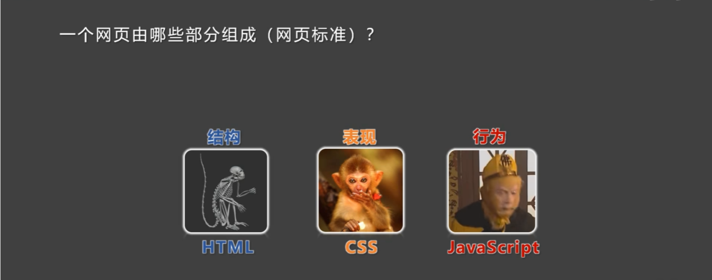

# HTML4

**HTML** 全称：HyperText Markup Language，译为“超文本标记语言”。

- **超文本**：暂且理解为“超级的文本”，和普通文本比内容更丰富。
- **标记**：文本要变成超文本，就需要用到各种标记符号。
- **语言**：每一个标记的写法、读音、使用规则，构成标记语言。

*一个网页由结构、表现、行为三部分组成：HTML 负责结构，CSS 负责表现，JavaScript 负责行为。*

## 本章目录

1. [快捷键](01-快捷键.md)
2. [结构](02-结构.md)
3. [标签](03-标签.md)
4. [超链接](04-超链接.md)
5. [列表](05-列表.md)
6. [表格](06-表格.md)
7. [表单](07-表单.md)
8. [框架标签](08-框架标签.md)
9. [字符实体](09-字符实体.md)
10. [全局属性](10-全局属性.md)
11. [meta 元信息](11-meta元信息.md)

---

← 返回 [前端技术开发目录](../README.md)
