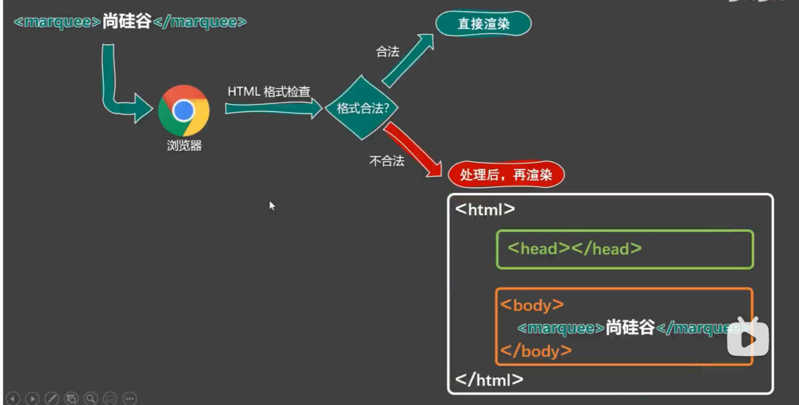

# 结构



在网页中，如何查看某段结构的具体代码？

—— 点击鼠标右键，选择“检查”。

【检查】和【查看网页源代码】的区别：

- 【查看网页源代码】看到的是：程序员编写的源代码。
- 【检查】看到的是：经过浏览器“处理”后的源代码。

> 备注：日常开发中，【检查】用得最多。

## 框架

一个 HTML 文档的基本框架如下：

```html
<html>
  <head>
    <title>网页标题</title>
  </head>
  <body>
    想要呈现在网页中的内容写在 body 标签中。
  </body>
</html>
```

- 想要呈现在网页中的内容写在 `body` 标签中。
- `head` 标签中的内容不会出现在网页中。
- `head` 标签中的 `title` 标签可以指定网页的标题。

## 注释

```html
<!-- 注释的内容 -->
```

## 文档声明

告诉浏览器以 H5 的版本渲染网页：

```html
<!DOCTYPE html>
```

## 字符编码

- 存储时，对数据进行：编码。
- 读取时，对数据进行：解码。
- 编码、解码，会遵循一定的规范 —— 字符集。
- 字符集有很多，UTF-8 最常用。

```html
<meta charset="UTF-8">
```

`<meta charset="UTF-8">` 写在 `<head>` 里面。

## 语言设置

```html
<html lang="zh-CN">
</html>
```

`lang` 属性用于指定网页的语言，常见取值如下：

| 写法 | 含义 |
| --- | --- |
| `zh-CN` | 中文-中国大陆（简体中文） |
| `zh-TW` | 中文-中国台湾（繁体中文） |
| `zh` | 中文 |
| `en-US` | 英语-美国 |
| `en-GB` | 英语-英国 |

第二种写法（语言-具体种类）已不推荐使用，例如：`zh-Hans`（中文-简体）、`zh-Hant`（中文-繁体）。

---

← 返回 [HTML4 章节目录](README.md)
