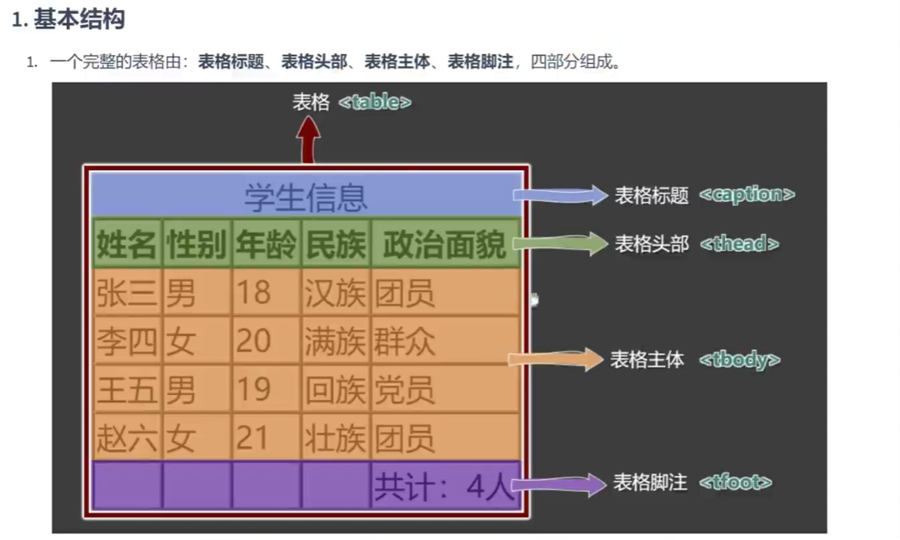

# 表格

## 基本结构

一个完整的表格由表格标题、表格头部、表格主体、表格脚注四部分组成。

表格涉及到的标签：

- `table`：表格
- `caption`：表格标题
- `thead`：表格头部
- `tbody`：表格主体
- `tfoot`：表格注脚
- `tr`：每一行
- `th`、`td`：每一个单元格（备注：表格头部中用 `th`，表格主体、表格脚注中用 `td`）

## 常用属性

| 标签名 | 标签语义 | 常用属性 | 单 / 双标签 |
| --- | --- | --- | --- |
| `table` | 表格 | `width`：设置表格宽度。 `height`：设置表格最小高度，表格最终高度可能比设置的值大。 `border`：设置表格边框宽度。 `cellspacing`：设置单元格之间的间距。 | 双 |
| `thead` | 表格头部 | `height`：设置表格头部高度。 `align`：设置单元格的水平对齐方式，可选值：`left`（左对齐）、`center`（中间对齐）、`right`（右对齐）。 `valign`：设置单元格的垂直对齐方式，可选值：`top`（顶部对齐）、`middle`（中间对齐）、`bottom`（底部对齐）。 | 双 |
| `tbody` | 表格主体 | 常用属性与 `thead` 相同。 | 双 |
| `tr` | 行 | 常用属性与 `thead` 相同。 | 双 |
| `tfoot` | 表格脚注 | 常用属性与 `thead` 相同。 | 双 |
| `td` | 普通单元格 | `width`：设置单元格的宽度，同列所有单元格全都受影响。 `height`：设置单元格的高度，同行所有单元格全都受影响。 `align`：设置单元格的水平对齐方式。 `valign`：设置单元格的垂直对齐方式。 `rowspan`：指定要跨的行数。 `colspan`：指定要跨的列数。 | 双 |
| `th` | 表头单元格 | 常用属性与 `td` 相同。 | 双 |

---

← 返回 [HTML4 章节目录](README.md)
