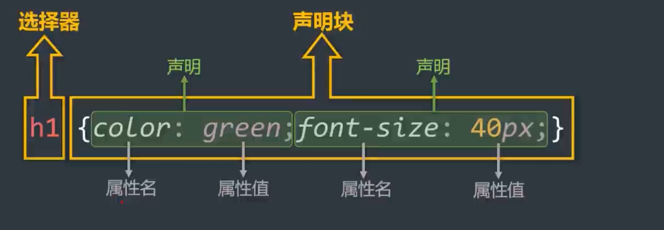

# 编写规则

CSS 的编写位置有三种：行内样式、内部样式、外部样式。

## 行内样式

写在标签的 `style` 属性中（又称：内联样式）。

语法：

```html
<h1 style="color:red;font-size:60px;">前端</h1>
```

注意点：

- `style` 属性的值不能随便写，要符合 CSS 语法规范，是 `名:值;` 的形式。
- 行内样式表只能控制当前标签的样式，对其他标签无效。

## 内部样式

写在 HTML 页面内部，将所有的 CSS 代码提取出来，单独放在 `<style>` 标签中。

语法：

```html
<style>
  h1 {
    color: red;
    font-size: 40px;
  }
</style>
```

注意点：

- `<style>` 标签理论上可以放在 HTML 文档的任何地方，但一般都放在 `<head>` 标签中。
- 此种写法：样式可以复用、代码结构清晰。

## 外部样式

写在单独的 `.css` 文件中，随后在 HTML 文件中引入使用。

语法：

1. 新建一个扩展名为 `.css` 的样式文件，把所有 CSS 代码都放入此文件中。
2. 在 HTML 文件中引入 `.css` 文件。

```html
<link rel="stylesheet" href="./xxx.css">
```

注意点：

- `<link>` 标签要写在 `<head>` 标签中。
- `<link>` 标签属性说明：
  - `href`：引入的文档来自于哪里。
  - `rel`（relation：关系）：说明引入的文档与当前文档之间的关系。
- 外部样式的优势：样式可以复用、结构清晰、可触发浏览器的缓存机制，提高访问速度，实现了结构与样式的完全分离。
- 实际开发中，几乎都使用外部样式，这是最推荐的使用方式！

## 样式表的优先级

优先级规则：行内样式 > 内部样式 = 外部样式。

1. 内部样式、外部样式，这二者的优先级相同，且后面的会覆盖前面的（简记：“后来者居上”）。
2. 同一个样式表中，优先级也和编写顺序有关，且后面的会覆盖前面的（简记：“后来者居上”）。

| 分类 | 优点 | 缺点 | 使用频率 | 作用范围 |
| --- | --- | --- | --- | --- |
| 行内样式 | 优先级最高 | 1. 结构与样式未分离<br>2. 代码结构混乱<br>3. 样式不能复用 | 很低 | 当前标签 |
| 内部样式 | 1. 样式可复用<br>2. 代码结构清晰 | 1. 结构与样式未彻底分离<br>2. 样式不能多页面复用 | 一般 | 当前页面 |
| 外部样式 | 1. 样式可多页面复用<br>2. 代码结构清晰<br>3. 可触发浏览器的缓存机制<br>4. 结构与样式彻底分离 | 需要引入才能使用 | 最高 | 多个页面 |

## 语法规则

CSS 语法由两部分构成：

- **选择器**：找到要添加样式的元素。
- **声明块**：设置具体的样式（声明块是由一个或多个声明组成的），声明的格式为：`属性名: 属性值;`。



备注：

1. 最后一个声明后的分号理论上能省略，但最好还是写上。
2. 选择器与声明块之间，属性名与属性值之间，均有一个空格，理论上能省略，但最好还是写上。

## 代码风格

展开风格 —— 开发时推荐，便于维护和调试。

```css
h1 {
  color: red;
  font-size: 40px;
}
```

紧凑风格 —— 项目上线时推荐，可减小文件体积。

```css
h1{color:red;font-size:40px;}
```

备注：

项目上线时，我们会通过工具将【展开风格】的代码变成【紧凑风格】，这样可以减小文件体积，节约网络流量，同时也能让用户打开网页时速度更快。

---

← 返回 [CSS2 章节目录](README.md)
