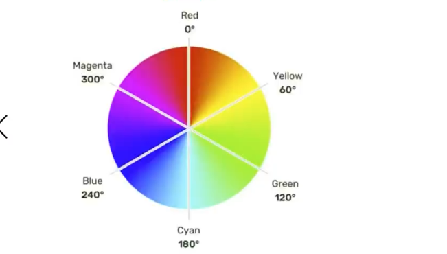

# 颜色的表示

## 表示方式一：颜色名

编写方式：直接使用颜色对应的英文单词，编写比较简单，例如：

| 颜色 | 英文名 |
| --- | --- |
| 红色 | red |
| 绿色 | green |
| 蓝色 | blue |
| 紫色 | purple |
| 橙色 | orange |
| 灰色 | gray |

> 1. 颜色名这种方式，表达的颜色比较单一，所以用的并不多。
> 2. 具体颜色名参考 MDN 官方文档：https://developer.mozilla.org/en-US/docs/Web/CSS/named-color

## 表示方式二：rgb 或 rgba

编写方式：使用红、黄、蓝这三种光的三原色进行组合。

- r 表示红色
- g 表示绿色
- b 表示蓝色
- a 表示透明度

举例：

```css
/* 使用 0~255 之间的数字表示一种颜色 */
color: rgb(255, 0, 0);       /* 红色 */
color: rgb(0, 255, 0);       /* 绿色 */
color: rgb(0, 0, 255);       /* 蓝色 */
color: rgb(0, 0, 0);         /* 黑色 */
color: rgb(255, 255, 255);   /* 白色 */

/* 混合出任意一种颜色 */
color: rgb(138, 43, 226);    /* 紫罗兰色 */
color: rgba(255, 0, 0, 0.5); /* 半透明的红色 */

/* 也可以使用百分比表示一种颜色（用的少） */
color: rgb(100%, 0%, 0%);        /* 红色 */
color: rgba(100%, 0%, 0%, 50%);  /* 半透明的红色 */
```

小规律：

1. 若三种颜色值相同，呈现的是灰色，值越大，灰色越浅。
2. `rgb(0, 0, 0)` 是黑色，`rgb(255, 255, 255)` 是白色。
3. 对于 rgba 来说，前三位的 rgb 形式要保持一致，要么都是 0~255 的数字，要么都是百分比。

## 表示方式三：HEX 或 HEXA

HEX 的原理与 rgb 一样，依然是通过红、绿、蓝色进行组合，只不过要用 6 个数字，分成 3 组来表达。

格式为：`#rrggbb`

> 每一位数字的取值范围是：0 ~ f，即：（0, 1, 2, 3, 4, 5, 6, 7, 8, 9, a, b, c, d, e, f）
> 所以每一种光的最小值是：00，最大值是：ff

```css
color: #ff0000;   /* 红色 */
color: #00ff00;   /* 绿色 */
color: #0000ff;   /* 蓝色 */
color: #000000;   /* 黑色 */
color: #ffffff;   /* 白色 */

/* 如果每种颜色的两位都是相同的，就可以简写 */
color: #ff9988;   /* 可简为：#f98 */

/* 但要注意前三位简写了，那么透明度也就简写 */
color: #ff998866; /* 可简为：#f986 */
```

注意点：IE 浏览器不支持 HEXA，但支持 HEX。

## 表示方式四：HSL 或 HSLA

HSL 是通过色相、饱和度、亮度，来表示一个颜色的，格式为：`hsl(色相,饱和度,亮度)`



- 色相：取值范围是 0~360 度，具体度数对应的颜色：
  - 0° Red（红）
  - 60° Yellow（黄）
  - 120° Green（绿）
  - 180° Cyan（青）
  - 240° Blue（蓝）
  - 300° Magenta（品红）
- 饱和度：取值范围是 0%~100%。（向色相中对应颜色中添加灰色，0% 全灰，100% 没有灰）
- 亮度：取值范围是 0%~100%。（0% 亮度没了，所以就是黑色，100% 亮度太强，所以就是白色了）

HSLA 其实就是在 HSL 的基础上，添加了透明度。

## 小结

| 表示方式 | 示例 | 特点 |
| --- | --- | --- |
| 颜色名 | `red` | 简单直观，但表达范围有限 |
| rgb / rgba | `rgb(255, 0, 0)`、`rgba(255, 0, 0, 0.5)` | 三原色数值 0~255，a 控制透明度 |
| HEX / HEXA | `#ff0000`、`#ff000080` | 6 位十六进制，两两相同可简写为 3 位 |
| HSL / HSLA | `hsl(0, 100%, 50%)`、`hsla(0, 100%, 50%, 0.5)` | 按色相/饱和度/亮度描述，符合直觉 |