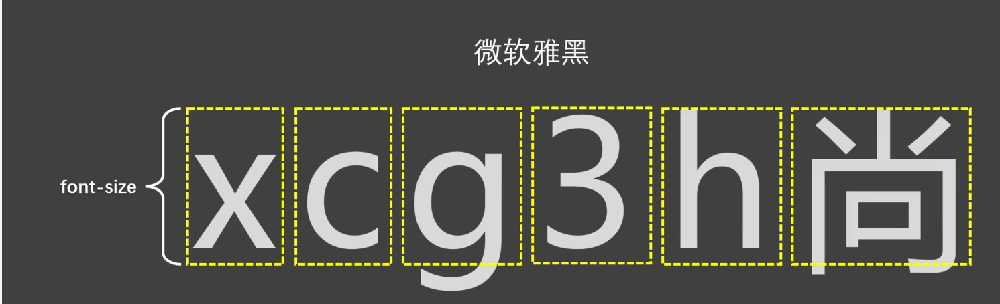

# 文本属性

## 文本颜色

- 属性名：`color`
- 可选值：

  1. 颜色名
  2. `rgb` 或 `rgba`
  3. `HEX` 或 `HEXA`（十六进制）
  4. `HSL` 或 `HSLA`

> 开发中常用的是：rgb/rgba 或 HEX/HEXA（十六进制）。

- 举例：

```css
div {
    color: rgb(112, 45, 78);
}
```

## 文本间距

- 字母间距：`letter-spacing`
- 单词间距：`word-spacing`（通过空格识别词）
- 属性值为像素（`px`），正值让间距增大，负值让间距缩小。

```html
body{
font-size: 40px;
}
 /* 字母间距 */
.dream1{
    letter-spacing: 20px;
}
 /* 单词间距 */
.dream2{
    word-spacing: 20px;
}
```

## 文本修饰

- 属性名：`text-decoration`
- 可选值：

  1. `none`：无装饰线（常用）
  2. `underline`：下划线（常用）
  3. `overline`：上划线
  4. `line-through`：删除线

  可搭配如下值使用：

  1. `dotted`：虚线
  2. `wavy`：波浪线
  3. 也可以指定颜色

- 举例：

```css
/*给超链接去除下划线*/
a {
    text-decoration: none;
}
/* 上划绿色虚线 */
.decoration1{
    text-decoration:overline dotted red;
}
/* 下划蓝色波浪线 */
.decoration2{
    text-decoration: underline wavy blue;
}
/* 删除线 */
.decoration3{
    text-decoration: line-through;
}
```

## 文本缩进

- 属性名：`text-indent`
- 属性值：css 中的长度单位，例如：`px`
- 举例：

```css
/*空两格*/
div {
    font-size:20px;
    text-indent: 40px;
}
```

> 后面我们会学习 css 中一些新的长度单位，目前我们只知道像素（`px`）。

## 文本对齐_水平

- 属性名：`text-align`
- 常用值：

  1. `left`：左对齐（默认值）
  2. `right`：右对齐
  3. `center`：居中对齐

- 举例：

```css
div {
    text-align: center;
}
```

## 补充：字体设计带来的两个现象

1. 由于字体设计原因，文字最终呈现的大小，并不一定与 font-size 的值一致，可能大，也可能小。
   例如：font-size 设为 40px，最终呈现的文字，可能比 40px 大，也可能比 40px 小。
2. 通常情况下，文字相对字体设计框，并不是垂直居中的，通常都靠下一些。



## 行高

- 属性名：`line-height`
- 可选值：

  1. `normal`：由浏览器根据文字大小决定的一个默认值。
  2. 像素（`px`）。
  3. 数字：参考自身 `font-size` 的倍数（很常用）。
  4. 百分比：参考自身 `font-size` 的百分比。

- 备注：由于字体设计原因，文字在一行中，并不是绝对垂直居中，若一行中都是文字，不会太影响观感。
- 举例（三种取值分别演示，实际只用一种）：

```css
div {
    line-height: normal;
    line-height: 60px;
    line-height: 1.5;
    line-height: 150%;
}
```

### 行高注意事项

> 1. `line-height` 过小会怎样？—— 文字产生重叠，且最小值是 0，不能为负数。
> 2. `line-height` 是可以继承的，且为了能更好的呈现文字，最好写数值。
> 3. `line-height` 和 `height` 是什么关系？
>    - 设置了 `height`，那么高度就是 `height` 的值。
>    - 不设置 `height` 的时候，会根据 `line-height` 计算高度。

### 应用场景

1. 对于多行文字：控制行与行之间的距离。
2. 对于单行文字：让 `height` 等于 `line-height`，可以实现文字垂直居中。

> 备注：由于字体设计原因，靠上述办法实现的居中，并不是绝对的垂直居中，但如果一行中都是文字，不会太影响观感。

```html
/* 应用场景1:调整多行文字的间距 */
#d5{
    font-size: 40px;
    background-color: skyblue;
    line-height: 100px;
}
/* 应用场景2:实现单行文字垂直居中 */
#d6{
    font-size: 40px;
    background-color: skyblue;
    height:300px;
    line-height: 300px;
}
```

## 文本对齐_垂直

1. **顶部**：无需任何属性，在垂直方向上，默认就是顶部对齐。
2. **居中**：对于单行文字，让 `height = line-height` 即可。

> 问题：多行文字垂直居中怎么办？—— 后面我们用定位去做。

3. **底部**：对于单行文字，目前一个临时的方式：
   让 `line-height =（height × 2）- font-size - x`。
   备注：`x` 是根据字体族，动态决定的一个值。

> 问题：垂直方向上的底部对齐，更好的解决办法是什么？—— 后面我们用定位去做。

```html
div{
    font-size: 40px;
    height: 400px;
    line-height: 760px;
    background-color: skyblue;
}
```

## vertical-align

- 属性名：`vertical-align`。
- 作用：用于指定同一行元素之间，或表格单元格内文字的垂直对齐方式。
- 常用值：

  1. `baseline`（默认值）：使元素的基线与父元素的基线对齐。
  2. `top`：使元素的顶部与其所在行的顶部对齐。
  3. `middle`：使元素的中部与父元素的基线加上父元素字母 x 的一半对齐。
  4. `bottom`：使元素的底部与其所在行的底部对齐。

> 特别注意：`vertical-align` 不能控制块元素!