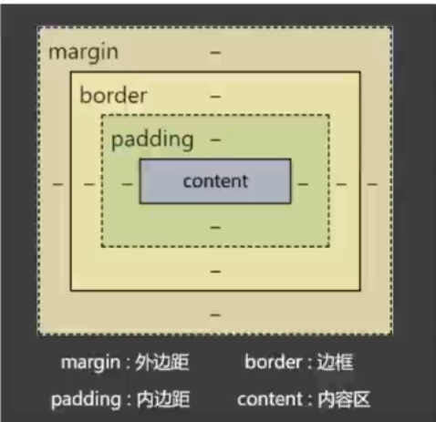
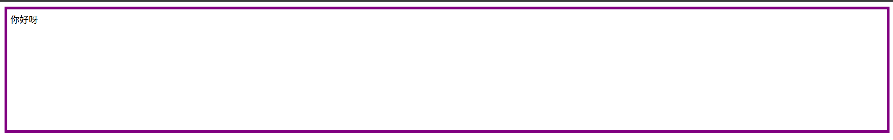
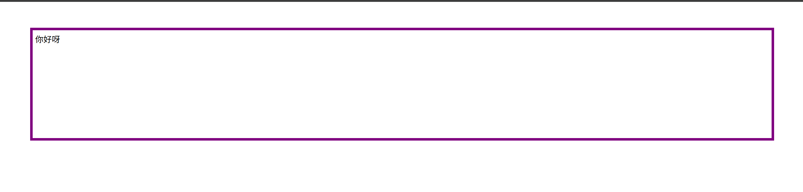
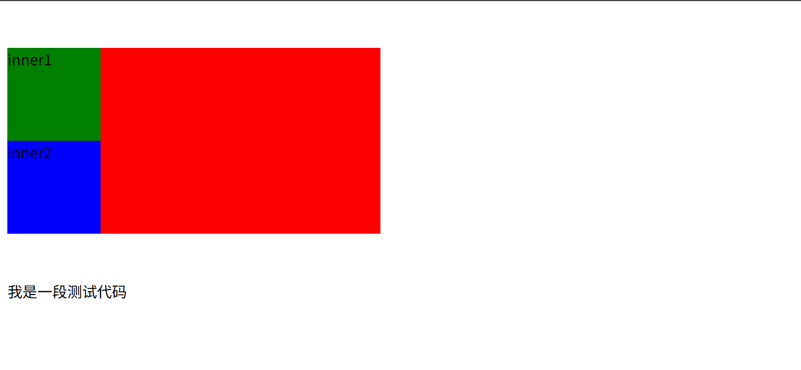
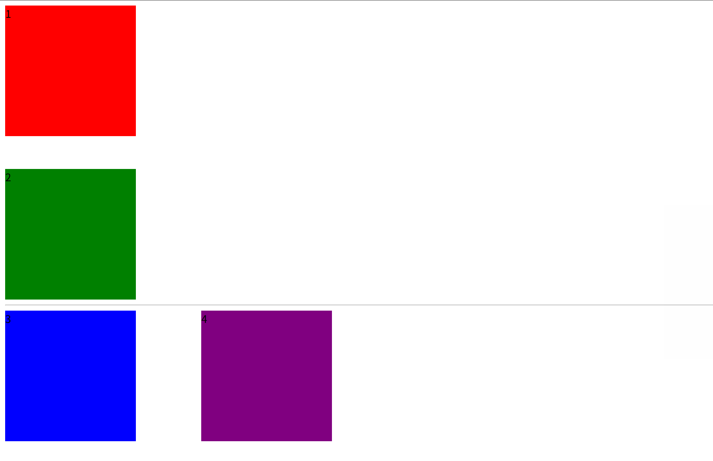
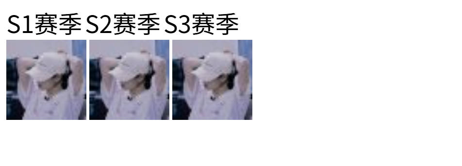

# CSS 盒子模型

## 1. CSS 长度单位

1. `px`：像素。
2. `em`：相对元素 `font-size` 的倍数。
3. `rem`：相对根字体大小，`html` 标签就是根。
4. `%`：相对父元素计算。

> 注意：CSS 中设置长度，必须加单位，否则样式无效！

### 示例代码

```css
html {
    font-size: 40px;
}

/* 第一种单位长度：px */
#d1 {
    width: 200px;
    height: 200px;
    font-size: 20px;
    background-color: red;
}

/* 第二种单位长度：em（相对于当前元素或其父元素的 font-size 的倍数） */
#d2 {
    width: 10em;      /* 10 × 20px = 200px */
    height: 10em;
    font-size: 20px;
    background-color: green;
}

/* 第三种单位长度：rem（相对于根元素 html 的 font-size 的倍数） */
#d3 {
    width: 5rem;      /* 5 × 40px = 200px */
    height: 5rem;
    font-size: 20px;
    background-color: blue;
}

/* 第四种单位长度：%（相对于父元素的百分比） */
#d4 {
    width: 200px;
    height: 200px;
    font-size: 20px;
    background-color: skyblue;
}
.inside {
    width: 50%;       /* 200px × 50% = 100px */
    height: 25%;      /* 200px × 25% = 50px */
    font-size: 150%;  /* 20px × 150% = 30px */
    background-color: white;
}
```

## 2. 元素的显示模式

### 块元素（block）

又称：块级元素

特点：

1. 在页面中独占一行，不会与任何元素共用一行，是从上到下排列的。
2. 默认宽度：撑满父元素。
3. 默认高度：由内容撑开。
4. 可以通过 CSS 设置宽高。

### 行内元素（inline）

又称：内联元素

特点：

1. 在页面中不独占一行，一行中不能容纳下的行内元素，会在下一行继续从左到右排列。
2. 默认宽度：由内容撑开。
3. 默认高度：由内容撑开。
4. 无法通过 CSS 设置宽高。

### 行内块元素（inline-block）

又称：内联块元素

特点：

1. 在页面中不独占一行，一行中不能容纳下的行内元素，会在下一行继续从左到右排列。
2. 默认宽度：由内容撑开。
3. 默认高度：由内容撑开。
4. 可以通过 CSS 设置宽高。

> 注意：元素早期只分为行内元素、块级元素，区分条件也只有一条：“是否独占一行”，如果按照这种分类方式，行内块元素应该算作行内元素。

## 3. 总结各元素的显示模式

### 块元素（block）

1. 主体结构标签：`<html>`、`<body>`
2. 排版标签：`<h1>` ~ `<h6>`、`<hr>`、`<p>`、`<pre>`、`<div>`
3. 列表标签：`<ul>`、`<ol>`、`<li>`、`<dl>`、`<dt>`、`<dd>`
4. 表格相关标签：`<table>`、`<tbody>`、`<thead>`、`<tfoot>`、`<tr>`、`<caption>`
5. `<form>` 与 `<option>`

### 行内元素（inline）

1. 文本标签：`<br>`、`<em>`、`<strong>`、`<sup>`、`<sub>`、`<del>`、`<ins>`
2. `<a>` 与 `<label>`

### 行内块元素（inline-block）

1. 图片：``
2. 表格单元格：`<td>`、`<th>`
3. 表单控件：`<input>`、`<textarea>`、`<select>`、`<button>`
4. 框架标签：`<iframe>`

## 4. 修改元素显示模式

通过 CSS 中的 `display` 属性可以修改元素的默认显示模式，常用值如下：

| 值 | 描述 |
| --- | --- |
| `none` | 元素会被隐藏。 |
| `block` | 元素将作为**块级元素**显示。 |
| `inline` | 元素将作为**内联元素**显示。 |
| `inline-block` | 元素将作为**行内块元素**显示。 |

### 示例

```css
/* 隐藏元素：不显示，也不占据位置 */
#a1 {
    display: none;
}

/* 变成块级：独占一行，可设宽高 */
#a2 {
    display: block;
    width: 120px;
    height: 40px;
}

/* 变成行内：不再独占一行，不能设置宽高 */
#div1 {
    display: inline;
}

/* 变成行内块：既能并排显示，又能设置宽高 */
#div2 {
    display: inline-block;
    width: 200px;
    height: 120px;
}
```

## 5. 盒子模型的组成

CSS 会把所有的 HTML 元素都看成一个盒子，所有的样式也都是基于这个盒子。

1. `margin`（外边距）：盒子与外界的距离。
2. `border`（边框）：盒子的边框。
3. `padding`（内边距）：紧贴内容的补白区域。
4. `content`（内容）：元素中的文本或后代元素都是它的内容。

### 图示



| 区域 | 名称 | 说明 |
| --- | --- | --- |
| `margin` | 外边距 | 盒子与外界的距离 |
| `border` | 边框 | 盒子的边框 |
| `padding` | 内边距 | 紧贴内容的补白区域 |
| `content` | 内容区 | 文本或后代元素所占的区域 |

**盒子的大小 = content + 左右 padding + 左右 border。**

> 注意：外边距 margin 不会影响盒子的大小，但会影响盒子的位置。

## 6. 盒子内容区（content）

| CSS 属性名 | 功能 | 属性值 |
| --- | --- | --- |
| `width` | 设置内容区域宽度 | 长度 |
| `max-width` | 设置内容区域的最大宽度 | 长度 |
| `min-width` | 设置内容区域的最小宽度 | 长度 |
| `height` | 设置内容区域的高度 | 长度 |
| `max-height` | 设置内容区域的最大高度 | 长度 |
| `min-height` | 设置内容区域的最小高度 | 长度 |

> 注意：
> `max-width`、`min-width` 一般不与 `width` 一起使用。
> `max-height`、`min-height` 一般不与 `height` 一起使用。

### 示例

```css
/* 固定宽高 */
div {
    width: 300px;
    height: 200px;
}

/* 限制最小 / 最大宽度，宽度可随内容或窗口伸缩 */
div {
    min-width: 320px;
    max-width: 960px;
}

/* 限制最小 / 最大高度范围，高度由内容撑开 */
div {
    min-height: 200px;
    max-height: 600px;
}
```

## 7. 关于默认宽度

所谓的默认宽度，就是**不设置 `width` 属性**时，元素所呈现出来的宽度。

**总默认宽度 = 父元素的 `content`宽度 − 自身的左右 `margin`。**

**内容区的默认宽度 = 父元素的 `content`宽度 − 自身的左右 `margin` − 自身的左右 `border` − 自身的左右 `padding`。**

这里可以简单理解为盒子的父元素是body

>注意:正常情况下margin不会影响宽度

因为如果不设置宽度,总的默认宽度就是视口的宽度,此时设置margin会影响总的默认宽度

margin=0px:



margin=50px:



## 8. 盒子内边距（padding）

| css 属性名 | 功能 | 属性值 |
| --- | --- | --- |
| `padding-top` | 上内边距 | 长度 |
| `padding-right` | 右内边距 | 长度 |
| `padding-bottom` | 下内边距 | 长度 |
| `padding-left` | 左内边距 | 长度 |
| `padding` | 复合属性 | 长度，可以设置 1~4 个值 |

### padding 复合属性的使用规则

1. `padding: 10px;`　四个方向内边距都是 10px。
2. `padding: 10px 20px;`　上 10px，左右 20px。（上下、左右）
3. `padding: 10px 20px 30px;`　上 10px，左右 20px，下 30px。（上、左右、下）
4. `padding: 10px 20px 30px 40px;`　上 10px，右 20px，下 30px，左 40px。（顺时针:上、右、下、左）

### 注意点

1. `padding` 的值**不能为负数**。
2. 行内元素的左右内边距是没问题的，**上下内边距不能完美的设置**。
3. 块级元素、行内块元素，四个方向内边距都可以完美设置。

## 9. 盒子边框（border）

### 9.1 常用边框属性

| css 属性名 | 功能 | 属性值 |
| --- | --- | --- |
| `border-style` | 边框线风格<br>**复合了四个方向的边框风格** | `none`：默认值<br>`solid`：实线<br>`dashed`：虚线<br>`dotted`：点线<br>`double`：双实线<br>…… |
| `border-width` | 边框线宽度<br>**复合了四个方向的边框宽度** | 长度，默认 3px |
| `border-color` | 边框线颜色<br>**复合了四个方向的边框颜色** | 颜色，默认黑色 |
| `border` | 复合属性 | 值没有顺序和数量要求。 |

### 9.2 分别设置各个方向的边框

| 方向 | 复合写法 | 单独设置风格 / 宽度 / 颜色 |
| --- | --- | --- |
| 左 | `border-left` | `border-left-style`、`border-left-width`、`border-left-color` |
| 右 | `border-right` | `border-right-style`、`border-right-width`、`border-right-color` |
| 上 | `border-top` | `border-top-style`、`border-top-width`、`border-top-color` |
| 下 | `border-bottom` | `border-bottom-style`、`border-bottom-width`、`border-bottom-color` |

> 边框相关属性共 **20 个**。
> 如图9.1里: `border-style`、`border-width`、`border-color` 其实也是复合属性,一下子设置四个方向
### 9.3 示例代码

```css
/* 分别设置风格、宽度、颜色 */
border-color: red;
border-width: 10px;
border-style: solid;

/* 复合写法：值没有顺序和数量要求 */
border: red 10px solid;

/* 分别设置四个方向的宽度 */
border-left-width: 10px;
border-right-width: 20px;
border-top-width: 30px;
border-bottom-width: 30px;

/* 分别设置四个方向的颜色 */
border-left-color: red;
border-right-color: blue;
border-top-color: green;
border-bottom-color: yellow;

/* 分别设置四个方向的风格 */
border-left-style: solid;
border-right-style: dashed;
border-top-style: double;
border-bottom-style: dotted;

/* 分别设置四个方向的边框（简写） */
border-left: 10px red solid;
border-right: 20px blue solid;
border-top: 30px green solid;
border-bottom: 40px yellow solid;
```

## 10. 盒子外边距_margin

| CSS 属性名 | 功能 | 属性值 |
| --- | --- | --- |
| `margin-left` | 左外边距 | CSS 中的长度值 |
| `margin-right` | 右外边距 | CSS 中的长度值 |
| `margin-top` | 上外边距 | CSS 中的长度值 |
| `margin-bottom` | 下外边距 | CSS 中的长度值 |
| `margin` | 复合属性，可以写 1~4 个值，规律同 padding（顺时针） | CSS 中的长度值 |

### 10.1 margin 注意事项

1. 子元素的 margin，是参考父元素的 content 计算的。**（因为父元素的 content 中装着子元素）**
.png)
2. 上 margin、左 margin：影响自己的位置；下 margin、右 margin：影响后面兄弟元素的位置。
3. 块级元素、行内块元素，均可以完美地设置四个方向的 margin；**但行内元素**的左右 margin 可以完美设置，**上下 margin 设置无效**。
4. margin 的值也可以是 auto，如果给一个块级元素设置**左右 margin** 都为 auto，该块级元素会在父元素中水平居中。
5. margin 的值可以是**负值**。

### 示例

```css
/* 四个方向 */
.box {
    margin-top: 10px;
    margin-right: 20px;
    margin-bottom: 30px;
    margin-left: 40px;
}

/* 复合写法：上 右 下 左（顺时针） */
.box {
    margin: 10px 20px 30px 40px;
}

/* 水平居中：左右 auto，上下为 0 */
.center {
    width: 600px;
    margin: 0 auto;
}
```

## 10.2 margin 塌陷问题

### 什么是 margin 塌陷？

第一个子元素的**上 margin** 会作用在父元素上，最后一个子元素的**下 margin** 会作用在父元素上。

### 如何解决 margin 塌陷？

- 方案一：给父元素设置不为 0 的 `padding`。
- 方案二：给父元素设置宽度不为 0 的 `border`。
- 方案三：给父元素设置 css 样式 `overflow: hidden`。

### 示例

```html
<div class="outer">
    <div class="inner1">inner1</div>
    <div class="inner2">inner2</div>
</div>
<div>我是一段测试代码</div
```

```css
.outer{
    width: 400px;
    background-color: red;
    /*解决方法1  */
    /* border: 10px black solid; */
    /*解决方法2  */
    /* padding: 10px; */
    /*解决方法3  */
    /* overflow: hidden; */
}
.inner1{
    width: 100px;
    height: 100px;
    background-color: green;
    /* 塌陷问题:把inner的margin-top给outer */
    margin-top: 50px;
}
.inner2{
    width: 100px;
    height: 100px;
    background-color: blue;
    /* 塌陷问题:把inner的margin-bottom给outer */
    margin-bottom: 50px;
}
```



## 10.3 margin 合并问题

### 什么是 margin 合并？

上面兄弟元素的**下外边距**和下面兄弟元素的**上外边距**会合并，取一个最大的值，而不是相加。

>水平左右设置margin就是正常的

### 如何解决 margin 塌陷？

无需解决，布局的时候上下的兄弟元素，只给一个设置上下外边距就可以了。

### 示例

```html
<div class=" box box1">1</div>
<div class=" box box2">2</div>
<hr>
<div class=" box box3">3</div><div class="box4">4</div>
```

```css
.box{
    width: 200px;
    height: 200px;
}
.box1{
    background-color: red;
    margin-bottom: 50px;
}
.box2{
    background-color: green;
    margin-top: 50px;
}
.box3{
    background-color: blue;
    display: inline-block;
    margin-right: 50px;
}
.box4{
    background-color: purple;
    display: inline-block;
    margin-left: 50px;
}
/* box1 与 box2 之间的实际间距 = 50px（取较大值），而不是 50 + 50 = 100px */
```



## 11. 处理内容溢出

| CSS 属性名 | 功能 | 属性值 |
| --- | --- | --- |
| `overflow` | 溢出内容的处理方式 | `visible`：显示，默认值<br>`hidden`：隐藏<br>`scroll`：显示滚动条，不论内容是否溢出<br>`auto`：自动显示滚动条，内容不溢出不显示 |
| `overflow-x` | 水平方向溢出内容的处理方式 | 同 `overflow` |
| `overflow-y` | 垂直方向溢出内容的处理方式 | 同 `overflow` |

### 注意

1. `overflow-x`、`overflow-y` 不能一个是 `hidden`，一个是 `visible`，是实验性属性，不建议使用。
2. `overflow` 常用的值是 `hidden` 和 `auto`，除了能处理溢出的显示方式，还可以解决很多疑难杂症。

### 示例

```css
/* 内容超出时出现滚动条，不超出时不显示 */
.box {
    width: 200px;
    height: 100px;
    overflow: auto;
}

/* 超出部分直接裁掉，不显示滚动条 */
.card {
    width: 200px;
    height: 100px;
    overflow: hidden;
}

```

## 12. 隐藏元素的方式

### 方式一：visibility 属性

`visibility` 属性默认值是 `show`，如果设置为 `hidden`，元素会隐藏。

元素看不见了，还占有原来的位置（元素的大小依然保持）。

### 方式二：display 属性

设置 `display: none`，就可以让元素隐藏。

彻底地隐藏，不但看不见，也不占用任何位置，没有大小宽高。

### 两种方式对比

| 方式 | 是否占位 | 是否参与布局 | 特点 |
| --- | --- | --- | --- |
| `visibility: hidden` | **占位** | 占位置但不显示 | 保留原有空间，布局不塌 |
| `display: none` | **不占位** | 完全不参与布局 | 相当于从页面中移除，后续元素会补位 |

### 示例

```css
.box1{
    width: 200px;
    height: 200px;
    background-color: red;
    /* 彻底隐藏，不占位置 */
    display: none;
    /* 看不见，但仍占位置 */
    visibility: hidden;
}
```

## 13. 样式的继承

有些样式会继承：元素如果本身设置了某个样式，就使用本身设置的样式；但如果本身没有设置某个样式，会从父元素开始一级一级继承（优先继承离得近的祖先元素）。

### 会继承的 css 属性

字体属性、文本属性（除了 `vertical-align`）、文字颜色 等。

### 不会继承的 css 属性

边框、背景、内边距、外边距、宽高、溢出方式 等。

> 一个规律：能继承的属性，都是不影响布局的，简单说：都是和盒子模型没关系的。

### 示例

```css
body {
    /* 可继承：所有后代文字变深灰 */
    color: #333;
    /* 可继承：所有后代用同一字体 */                      
    font-family: "Microsoft YaHei";   
    font-size: 16px;                  
}

.box {
    /* 不可继承 */
    border: 1px solid #ccc;           
    padding: 20px;                    
    background-color: #f5f5f5;        
}
```

## 15. 布局小技巧

### 1. 行内元素、行内块元素可以被父元素当做文本处理

> 即：可以像处理文本对齐一样，去处理行内、行内块在父元素中的对齐。
> 例如：`text-align`、`line-height`、`text-indent` 等。

### 2. 如何让子元素在父元素中水平居中

- 若子元素为**块元素**，给子元素加上：`margin: 0 auto;`。
- 若子元素为**行内元素、行内块元素**，给父元素加上：`text-align: center;`。

```css
/* 块级子元素：自身要有宽度，再左右 auto */
.child-block {
    width: 600px;
    margin: 0 auto;
}

/* 行内 / 行内块子元素：父元素设 text-align */
.parent {
    text-align: center;
}
```

### 3. 如何让子元素在父元素中垂直居中

- 若子元素为**块元素**，给子元素加上 `margin-top`，值为：`(父元素 content − 子元素盒子总高) / 2`。

- 若子元素为**行内元素、行内块元素**：
  让父元素的 `height = line-height`，每个子元素都加上 `vertical-align: middle;`。

>补充：
若想绝对垂直居中，父元素 `font-size` 设置为 0。
有需要再单独给指定文字加font-size

```css
.outer{
    width: 400px;
    height: 400px;
    background-color: skyblue;
    text-align: center;
    /* 让行内元素/行内块元素垂直居中 */
    line-height: 400px;
    /* 消除文字基线带来的偏移 */
    font-size: 0px;
}
img{
    vertical-align: middle;
}
span{
    /* 可以单独给文字加大小 */
    font-size: 40px;
    vertical-align: middle;
}
```

## 16. 元素之间的空白问题

### 产生的原因

行内元素、行内块元素，彼此之间的换行会被浏览器解析为一个空白字符。



### 解决方案

1. **方案一**：去掉换行和空格（不推荐）。
2. **方案二**：给父元素设置 `font-size: 0`，再给需要显示文字的元素，单独设置字体大小（推荐）。

### 示例

```css
body{
/* 解决方法:给body设置font-size为0px */
font-size: 0px;
}
```

## 17. 行内块的幽灵空白问题

### 产生原因

行内块元素与文本的基线对齐，而文本的基线到文本最底端之间是有一定距离的。

### 解决方案

1. **方案一**：给行内块设置 `vertical-align`，值不为 `baseline` 即可，设置为 `middle`、`bottom`、`top` 均可。
2. **方案二**：若父元素中只有一张图片，设置图片为 `display: block`。
3. **方案三**：给父元素设置 `font-size: 0`。如果该行内块内部还有文本，则需单独设置 `font-size`。

### 示例

```html
<div class="box">
    
</div>
```

```css
div{
    width: 600px;
    background-color: skyblue;
    /* 解决方法3:将字体设置为0px */
    font-size: 0px;
}
img{
    height: 200px;
    /* 解决方法1前提:有文字,vertical-align只能用于行内元素/行内块元素 */
    vertical-align: bottom;
    /* 解决方法2前提:没有文字,直接设置成块级元素 */
    display: block;
}
```

