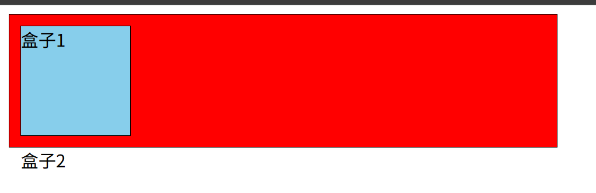

# 浮动

## 1. 浮动的简介

在最初，浮动是用来实现文字环绕图片效果的，现在浮动是主流的页面布局方式之一。

```css
/* 让图片左浮动，文字环绕在右侧 */
img {
    float: left;
    margin-right: 10px;
}
```

## 2. 元素浮动后的特点

1. 脱离文档流。
2. 不管浮动前是什么元素，浮动后：默认宽与高都是被内容撑开（尽可能小），而且可以设置宽高。
3. 不会独占一行，可以与其他元素共用一行。
4. **不会 margin 合并**，也不会 margin 塌陷，能够完美的设置四个方向的 margin 和 padding。
5. 不会像行内块一样被当做文本处理 **（没有行内块的空白问题）**

```css
.box {
    float: left;      /* 取值：left / right / none（默认） */
    width: 200px;     /* 浮动后可以设置宽高 */
    height: 100px;
    margin: 20px;     /* 四个方向都可完美生效 */
    padding: 10px;
}
```

## 3. 浮动后会有哪些影响

**对兄弟元素的影响**：后面的兄弟元素，**会占据浮动元素之前的位置**(在浮动元素的下面；)对前面的兄弟无影响。

**对父元素的影响**：**不能撑起父元素的高度**，导致父元素高度塌陷；但父元素的宽度依然束缚浮动的元素。

### 示例

**对父元素产生的影响**

```html
<div class="outer">
    <div class="box box1">盒子1</div>
    <div class="box box2">盒子2</div>
    <div class="box box3">盒子3</div>
</div>
```

```css
.outer{
    width: 500px;
    background-color: red;
    border: 1px solid black;
}
.box{
    width: 100px;
    height: 100px;
    background-color: skyblue;
    border: 1px solid black;
    margin: 10px;
}
.box1,.box2,.box3{
    float: left;
}
```

**对后面兄弟产生的影响**

```html
<div class="outer">
    <div class="box box1">盒子1</div>
    <div class="box box2">盒子2</div>
</div>
```

.png)

```css
.outer{
    width: 500px;
    background-color: red;
    border: 1px solid black;
}
.box{
    width: 100px;
    height: 100px;
    background-color: skyblue;
    border: 1px solid black;
    margin: 10px;
}
.box1{
    float: left;
}
```


## 4. 解决浮动产生的影响（清除浮动）

### 解决方案

1. **方案一**：给父元素指定高度。
2. **方案二**：给父元素也设置浮动，带来其他影响。
3. **方案三**：给父元素设置 `overflow: hidden`。
4. **方案四**：在所有浮动元素的最后面，添加一个块级元素，并给该块级元素设置 `clear: both`。
5. **方案五**：给浮动元素的父元素，设置伪元素，通过伪元素清除浮动，原理与方案四相同。===> **推荐使用**

```css
.parent::after {
    content: "";
    display: block;
    clear: both;
}
```

> 布局中的一个原则：设置浮动的时候，兄弟元素要么全都浮动，要么全都不浮动。

**注意:**
方案四和五思路差不多,都是在后面加一个空白的块级元素,就会顶替前面的浮动兄弟的位置,撑起高度(利用了浮动产生的影响)
>方案四可以解决高度坍塌和不浮动兄弟占位两个影响
>方案五只能解决高度坍塌
>看上去方案四最好,但比较麻烦,在布局原则下推荐方案五
