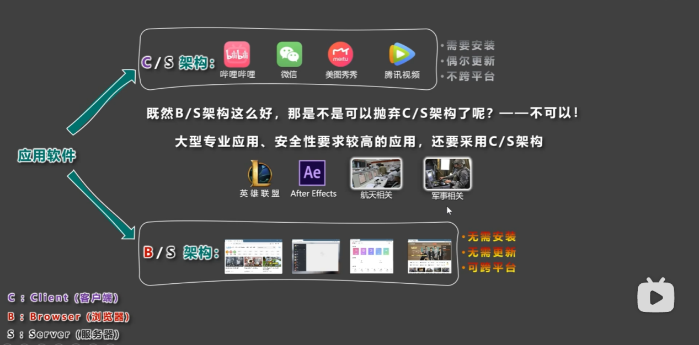
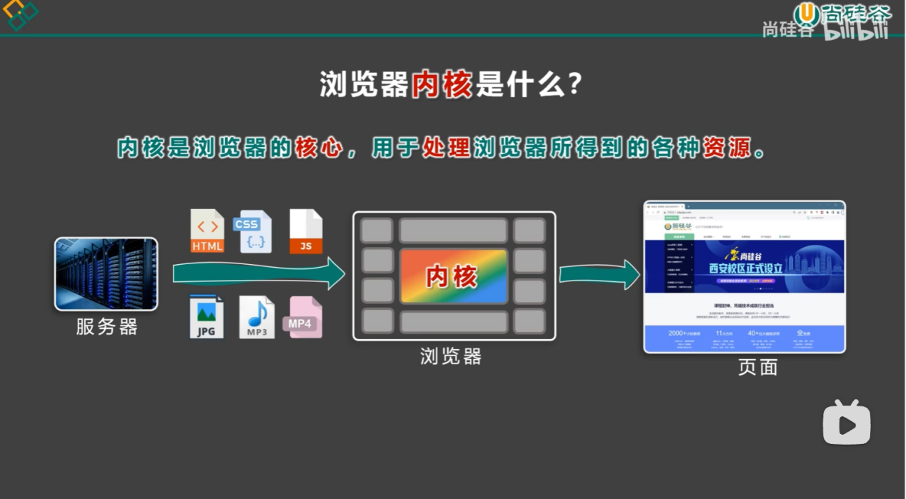

# 前端技术开发

> 前端入门学习笔记，涵盖 HTML4 与 CSS2 两部分。

## 目录

### HTML4

1. [快捷键](HTML4/01-快捷键.md)
2. [结构](HTML4/02-结构.md)
3. [标签](HTML4/03-标签.md)
4. [超链接](HTML4/04-超链接.md)
5. [列表](HTML4/05-列表.md)
6. [表格](HTML4/06-表格.md)
7. [表单](HTML4/07-表单.md)
8. [框架标签](HTML4/08-框架标签.md)
9. [字符实体](HTML4/09-字符实体.md)
10. [全局属性](HTML4/10-全局属性.md)
11. [meta 元信息](HTML4/11-meta元信息.md)

### CSS2

1. [编写规则](CSS2/01-编写规则.md)
2. [选择器](CSS2/02-选择器.md)
3. [复合选择器](CSS2/03-复合选择器.md)

## 关于本笔记

- 原文档中的每个三级标题整理为一个独立的 Markdown 文件，分别放在 `HTML4`、`CSS2` 两个文件夹中。
- 原文档中的图片已提取到对应目录的 `images` 文件夹；图片中的表格和代码已转写为 Markdown 表格或代码块。
- HTML、CSS 示例统一放入带语言标记的代码块，方便阅读和复制。

## 前言

应用软件主要有两种架构：C/S 架构与 B/S 架构。前端开发属于 B/S 架构中的浏览器端。

*C/S（Client/Server）与 B/S（Browser/Server）架构对比。*

浏览器内核负责处理浏览器获取到的各种资源，最终把页面渲染出来。

*浏览器内核负责解析 HTML、CSS、JavaScript 以及图片、音视频等资源，并渲染页面。*
